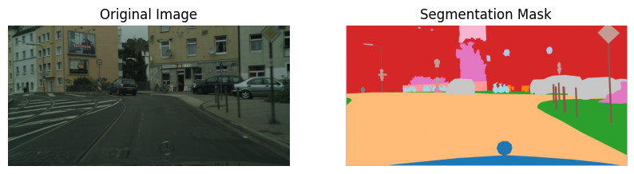
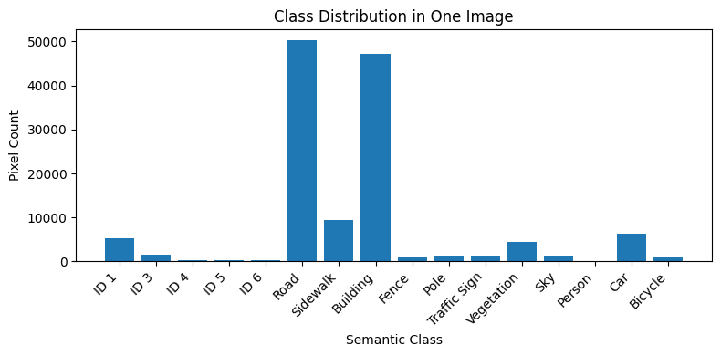
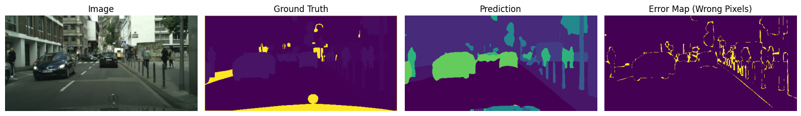
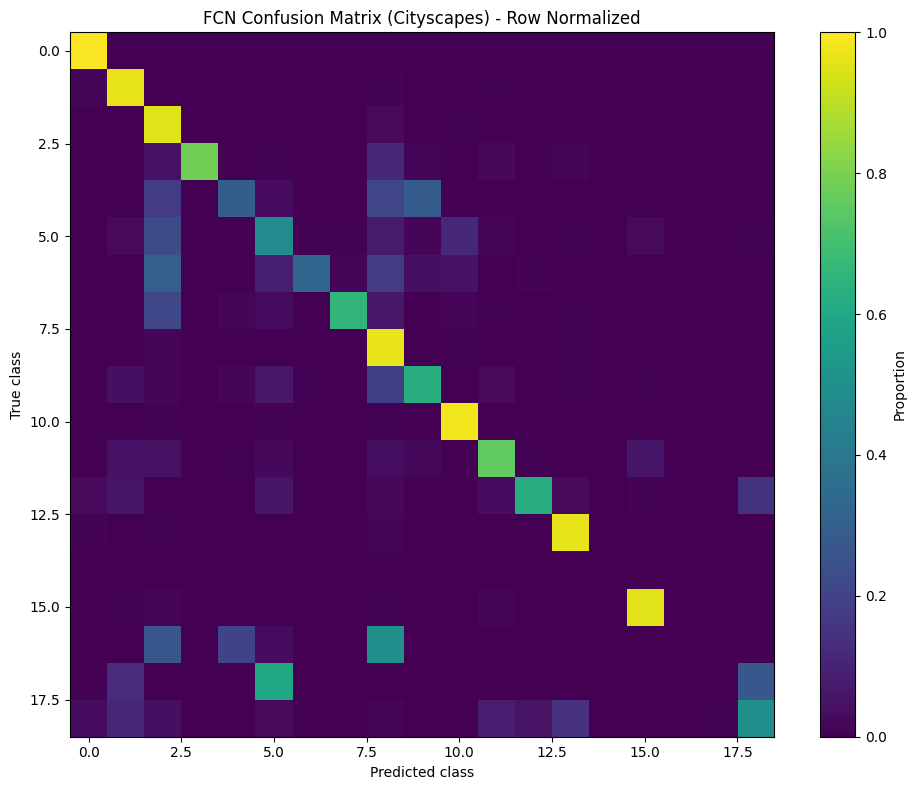

<a id="readme-top"></a>

<div align="center">

# 🚗 Semantic Segmentation of Road Scenes

### Pixel-level understanding of urban streets with FCN and DeepLabV3 on Cityscapes

<p>
  
  
  
  
  
  
</p>

<p>
  <a href="#-overview"><b>Overview</b></a> ·
  <a href="#-pipeline"><b>Pipeline</b></a> ·
  <a href="#-results"><b>Results</b></a> ·
  <a href="#-getting-started"><b>Getting Started</b></a> ·
  <a href="semantic-segmetation-official.ipynb"><b>Notebook</b></a>
</p>



<sub>A Cityscapes street scene and its ground-truth segmentation mask</sub>

</div>

<br>

## 📖 Table of Contents

<details open>
<summary>Click to expand</summary>

1. [Overview](#-overview)
2. [Dataset](#-dataset)
3. [Pipeline](#-pipeline)
4. [Models](#-models)
5. [Results](#-results)
6. [Getting Started](#-getting-started)
7. [Project Structure](#-project-structure)
8. [Key Takeaways](#-key-takeaways)
9. [Future Work](#-future-work)
10. [Course Information](#-course-information)

</details>

<br>

## 💡 Overview

Image classification gives one label to a whole picture. **Semantic segmentation** goes much further and assigns a class to **every single pixel**, so the model knows exactly where the road ends, where the sidewalk begins and which pixels belong to a car or a pedestrian. This kind of dense scene understanding is a core building block of autonomous driving and intelligent transportation systems.

This project builds the full segmentation pipeline in **PyTorch**, from loading and relabeling the Cityscapes dataset to training, evaluating and visualizing two convolutional segmentation networks:

| Model | Role | Key idea |
| :- | :- | :- |
| **FCN-ResNet50** | Baseline | Fully convolutional network that upsamples deep ResNet features back to full resolution |
| **DeepLabV3-ResNet50** | Advanced | Atrous (dilated) convolutions and ASPP to capture multi-scale context |

Both models share the exact same preprocessing, loss function, optimizer and number of classes, so the comparison is fair.

<p align="right">(<a href="#readme-top">back to top</a>)</p>

## 🗂️ Dataset

The project uses the [**Cityscapes**](https://www.cityscapes-dataset.com/) dataset (fine annotations, `train` split), loaded through `torchvision.datasets.Cityscapes`.

* High-resolution **2048 × 1024** RGB images of urban street scenes from German cities
* Pixel-wise semantic annotation masks
* Original Cityscapes label IDs **remapped to the 19 standard training classes**
* Void and unused labels set to `255` and ignored during training with `ignore_index`

<details>
<summary><b>🏷️ The 19 training classes</b></summary>

<br>

| ID | Class | ID | Class | ID | Class |
| :-: | :- | :-: | :- | :-: | :- |
| 0 | Road | 7 | Traffic sign | 14 | Truck |
| 1 | Sidewalk | 8 | Vegetation | 15 | Bus |
| 2 | Building | 9 | Terrain | 16 | Train |
| 3 | Wall | 10 | Sky | 17 | Motorcycle |
| 4 | Fence | 11 | Person | 18 | Bicycle |
| 5 | Pole | 12 | Rider | | |
| 6 | Traffic light | 13 | Car | | |

</details>

Classes are heavily imbalanced. Road and building pixels dominate most scenes, while poles, traffic lights and riders cover only a tiny share of the image:

<div align="center">
  
</div>

<p align="right">(<a href="#readme-top">back to top</a>)</p>

## ⚙️ Pipeline

```text
  Cityscapes image (2048 × 1024)            Cityscapes label mask
               │                                      │
               ▼                                      ▼
   Resize to 256 × 512 (bilinear)        Resize to 256 × 512 (nearest neighbor)
               │                                      │
               ▼                                      ▼
       Convert to tensor              Remap label IDs to 19 classes, void = 255
               │                                      │
               └──────────────────┬───────────────────┘
                                  ▼
                 DataLoader (batch size 4, shuffled)
                                  │
                                  ▼
          FCN-ResNet50  or  DeepLabV3-ResNet50  (19 output channels)
                                  │
                                  ▼
          Cross-Entropy loss (ignore_index = 255) + Adam (lr = 1e-4)
                                  │
                                  ▼
       Evaluation: confusion matrices, error maps, mean IoU, side-by-side views
```

**Why nearest neighbor for masks?** Mask values are class IDs, not intensities. Bilinear resizing would blend neighboring IDs into new, meaningless labels, so masks are resized with nearest neighbor and kept as integers.

<p align="right">(<a href="#readme-top">back to top</a>)</p>

## 🧠 Models

| Setting | Value |
| :- | :- |
| **Framework** | PyTorch + torchvision segmentation models |
| **Backbone** | ResNet50 (ImageNet pretrained backbone weights) |
| **Output classes** | 19 |
| **Input resolution** | 256 × 512 |
| **Batch size** | 4 |
| **Loss** | Cross-Entropy with `ignore_index=255` |
| **Optimizer** | Adam, learning rate `1e-4` |
| **Epochs** | 14 |
| **Hardware** | Kaggle GPU (CUDA) |

<p align="right">(<a href="#readme-top">back to top</a>)</p>

## 📊 Results

### Training loss

Both models learned steadily. DeepLabV3 started from a noticeably lower loss in its first epochs, which reflects its richer multi-scale context.

| Epoch | 1 | 3 | 5 | 7 | 9 | 11 | 14 |
| :- | :-: | :-: | :-: | :-: | :-: | :-: | :-: |
| **FCN-ResNet50** | 0.386 | 0.212 | 0.176 | 0.143 | 0.139 | 0.119 | **0.098** |
| **DeepLabV3-ResNet50** | 0.267 | 0.196 | 0.169 | 0.143 | **0.128** | | |

> [!NOTE]
> The saved notebook shows the DeepLabV3 run up to epoch 9. Its training session was cut short in epoch 10, so the later epochs are not recorded.

### FCN predictions

From left to right: input image, ground truth, FCN prediction, and an error map where yellow marks misclassified pixels.

<div align="center">
  
</div>

Most errors sit on **object boundaries** and **thin structures** such as poles and signs, while large regions like road, building, sky and cars are segmented cleanly.

### Confusion matrix

<table>
<tr>
<td width="50%">
  
</td>
<td width="50%" valign="top">

**Reading the matrix**

* Rows are the **true** class, columns the **predicted** class.
* Each row is normalized so it sums to 1, giving every class equal weight regardless of how common it is.
* A bright **diagonal** means the class is recognized well. Road, sidewalk, building, vegetation, sky, car and bus all score close to 1.
* Bright cells **off the diagonal** show confusions. Fences and traffic lights are often predicted as building or vegetation, and the few motorcycle pixels are confused with poles and bicycles.

</td>
</tr>
</table>

> [!NOTE]
> The confusion matrix and error map come from a single batch of training images, so they illustrate model behavior rather than serve as a benchmark score.

The notebook also computes **mean IoU** from each model's confusion matrix and plots DeepLabV3 and FCN predictions side by side with a class legend.

<p align="right">(<a href="#readme-top">back to top</a>)</p>

## 🚀 Getting Started

The notebook is designed to run on **Kaggle**, which provides a free GPU and hosts the dataset.

### Run on Kaggle (recommended)

1. Create a new notebook on [Kaggle](https://www.kaggle.com/) and import `semantic-segmetation-official.ipynb`.
2. Click **Add Input** and attach the **`cityscape-semantic-dataset`** dataset from Kaggle Datasets.
3. Make sure it appears under `../input/cityscape-semantic-dataset/data`.
4. Turn on a **GPU accelerator** in the notebook settings.
5. Run the cells in order.

### Run locally

You'll need an NVIDIA GPU for reasonable training times.

```bash
git clone https://github.com/bossshhh/Semantic-Segmentation-of-road-scenes.git
cd Semantic-Segmentation-of-road-scenes
pip install torch torchvision numpy matplotlib seaborn scikit-learn tqdm pillow jupyter
jupyter notebook semantic-segmetation-official.ipynb
```

Then download Cityscapes from the [official website](https://www.cityscapes-dataset.com/) (free registration required) and update the `root` path in the dataset cell to point at your copy.

<p align="right">(<a href="#readme-top">back to top</a>)</p>

## 📁 Project Structure

```text
Semantic-Segmentation-of-road-scenes/
├── semantic-segmetation-official.ipynb   # Full pipeline: EDA, training, evaluation
├── assets/                               # Figures used in this README
└── README.md
```

<p align="right">(<a href="#readme-top">back to top</a>)</p>

## 🔑 Key Takeaways

* **Masks need special care.** Nearest neighbor resizing and explicit ID remapping are essential, or the labels silently get corrupted.
* **Fully convolutional encoders work.** Pretrained CNN backbones adapt well to dense, pixel-level prediction.
* **Architecture matters.** Atrous convolutions in DeepLabV3 capture multi-scale context and gave a lower loss early in training.
* **Class imbalance shows up in the results.** Large, frequent classes are learned quickly, while thin and rare classes stay the hardest.
* **Device management matters.** Keeping the model and tensors on the same device is critical for stable training and evaluation.

<p align="right">(<a href="#readme-top">back to top</a>)</p>

## 🗺️ Future Work

- [ ] Train DeepLabV3 for the full schedule and add learning-rate scheduling
- [ ] Add data augmentation (flips, crops, color jitter) to improve generalization
- [ ] Normalize inputs with ImageNet statistics to match the pretrained backbone
- [ ] Report mean IoU on the full Cityscapes **validation** split
- [ ] Handle class imbalance with weighted loss or focal loss
- [ ] Try U-Net and attention-based models such as SegFormer

<p align="right">(<a href="#readme-top">back to top</a>)</p>

## 🎓 Course Information

| | |
| :- | :- |
| **Course** | Introduction to Neural Networks |
| **Project type** | Group project (2 members) |
| **Author** | [Bashar Soufan](https://github.com/bossshhh) |

### Acknowledgements

* [Cityscapes Dataset](https://www.cityscapes-dataset.com/) by Cordts et al., *The Cityscapes Dataset for Semantic Urban Scene Understanding*, CVPR 2016
* [torchvision segmentation models](https://pytorch.org/vision/stable/models.html#semantic-segmentation)
* Long et al., *Fully Convolutional Networks for Semantic Segmentation*, CVPR 2015
* Chen et al., *Rethinking Atrous Convolution for Semantic Image Segmentation* (DeepLabV3), 2017

<br>

<div align="center">

If you found this project useful, consider giving it a ⭐

<sub>Built with PyTorch 🔥</sub>

</div>

<p align="right">(<a href="#readme-top">back to top</a>)</p>
